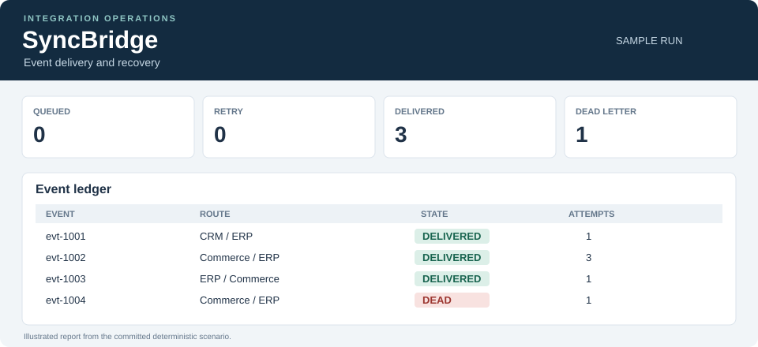

# SyncBridge

Durable event delivery and recovery for enterprise application integrations.



SyncBridge accepts customer, order and inventory events from simulated CRM, commerce and ERP systems. It validates and maps payloads, persists events in SQLite, retries transient failures and exposes an operator ledger for inspection and replay.

[Sample run](docs/sample-run.md) · [Standalone demo](demo.html) · [API reference](docs/api.md) · [Design](docs/design.md)

## Capabilities

- Versioned REST ingestion with bearer authentication and bounded JSON requests.
- Explicit event routes and field mappings; duplicate IDs accepted only when the normalized event matches.
- Durable queue, exponential backoff, dead-letter state and replay history.
- Operator dashboard, structured delivery logs and health endpoints.
- Node.js 24, SQLite, native HTTP, zero npm runtime dependencies.

Target adapters are deterministic simulations. A delivery receipt is written to SQLite in the same transaction as the queue update. No commercial ERP credentials or services are required.

## Review without setup

The [sample run](docs/sample-run.md) records three successful deliveries and one permanent rejection. Download [demo.html](demo.html) and open it in a browser to step through the scenario. The standalone demo shares the service's mapping and retry rules, with an in-memory clock.

## Run locally

Requires Node.js 24 or later.

```sh
export SYNCBRIDGE_API_KEY="$(node -e "process.stdout.write(require('node:crypto').randomBytes(24).toString('hex'))")"
export ENABLE_SIMULATION=1
npm start
```

From a second terminal, set the same API key and submit an event:

```sh
curl -i http://127.0.0.1:8080/api/v1/events \
  -H "Authorization: Bearer $SYNCBRIDGE_API_KEY" \
  -H 'Content-Type: application/json' \
  --data '{"id":"evt-1001","type":"customer.updated","source":"crm","payload":{"customer_id":"C-100","name":"Northline Supply","email":"ops@example.test"}}'
```

Open http://127.0.0.1:8080 and enter the key. See the [API reference](docs/api.md) for the remaining routes and fault scenarios.

## Container

```sh
docker build -t syncbridge .
docker volume create syncbridge-data
docker run --rm -p 127.0.0.1:8080:8080 \
  -e SYNCBRIDGE_API_KEY="$SYNCBRIDGE_API_KEY" \
  -e ENABLE_SIMULATION=1 \
  -v syncbridge-data:/app/data syncbridge
```

Fault injection is disabled by default. The service binds to localhost by default; the container binds internally to all interfaces. Use TLS termination, rate limiting and access controls for nonlocal deployments. The container runs as a nonroot user with a persistent SQLite volume.

## Tests

```sh
npm test
```

The suite covers mapping, input validation, retry scheduling, idempotency, restart recovery, dead-letter replay, HTTP authentication and ingestion, and a 10,000-event synthetic workload. The workload checks delivery counts, not a throughput SLA. CI is configured for pushes and pull requests.

## Scope

This is a deployment-oriented integration lab. Real external connectors require target-side idempotency, secret rotation, TLS, operational alerting, retention, backup/restore testing and load testing. The atomic delivery guarantee applies to simulated targets in the local database.
