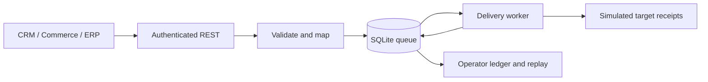

# Design

SQLite is the queue and local receipt store. Each worker transaction selects one due event, records its attempt and updates its state. A successful simulated delivery inserts a receipt keyed by event ID in the same transaction. Accepted events persist across restarts.

States: queued, retry, delivered, dead. Transient failures retry after 1, 2 and 4 seconds; the fourth failure becomes dead. Permanent failures go directly to dead. Replay preserves history and starts a new attempt cycle.

One process is the intended deployment. SQLite serializes writes; transactions never include remote network calls. A real adapter needs claim leases, target-side idempotency and handling for ambiguous outcomes.

The standalone demo uses an in-memory clock. The live dashboard reads the authenticated API and does not persist its API key.
